# Demo: from an architect's drawing to an electrical layout

Two real projects from the office's archive, neither used for training. For each: the architect's raw drawing, our cleaned base plan and our electrical layout as DWG (they open in AutoCAD), pictures, and a comparison with the electrical engineer's own drawing of the same building.

Devices: ceiling light (orange ring with a cross), socket (red dot), wet-area socket (purple square), switch (blue triangle), apartment panel (grey bar), emergency light (green ring with a dot). In the comparison pictures a filled dot is the engineer's device and a ring is ours.

## Cevriye Berkoğlu

- 3 floor plans found; sections, elevations, site plan and details removed
- 49 rooms read; 36 of 41 within 10% of the area the architect wrote
- 153 devices placed; agreement with the engineer **F1 0.66** (devices within 1 m)

Files: [1-architect-raw.dwg](cevriye-berkoglu/1-architect-raw.dwg) · [2-cleaned.dwg](cevriye-berkoglu/2-cleaned.dwg) · [3-electrical.dwg](cevriye-berkoglu/3-electrical.dwg)

The whole sheet: dark is what the cleanup kept, pink what it removed.

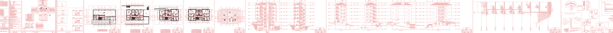

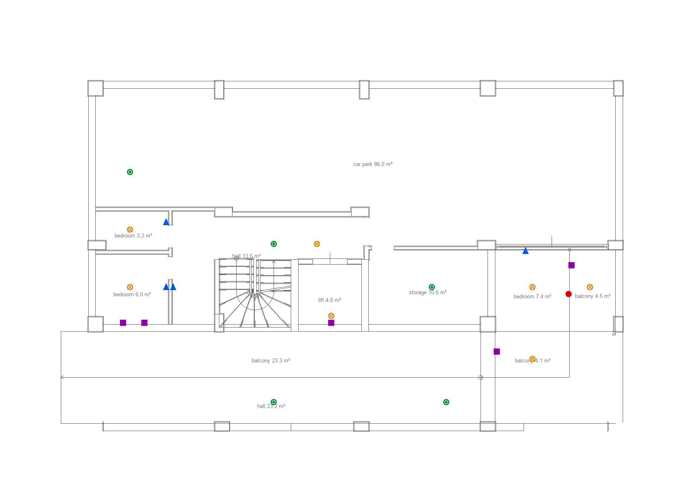

Ours vs the engineer's:

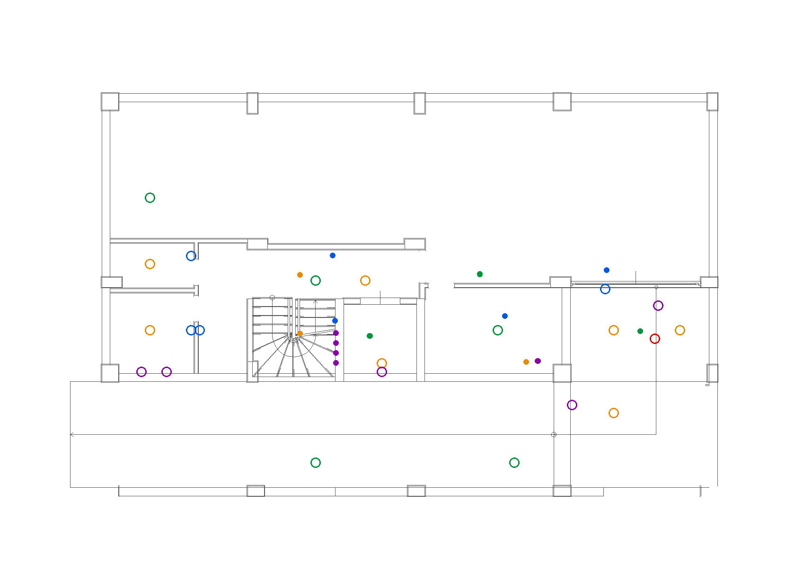

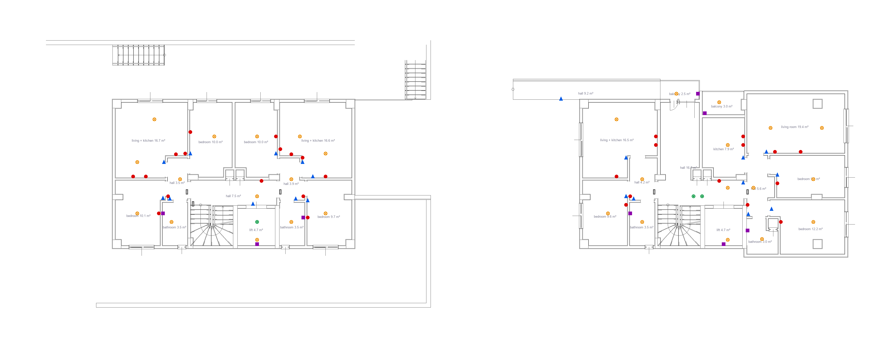

Ours vs the engineer's:

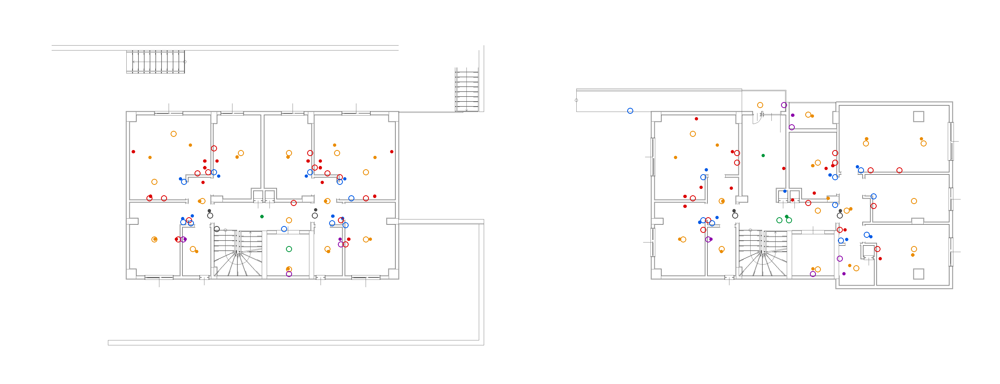

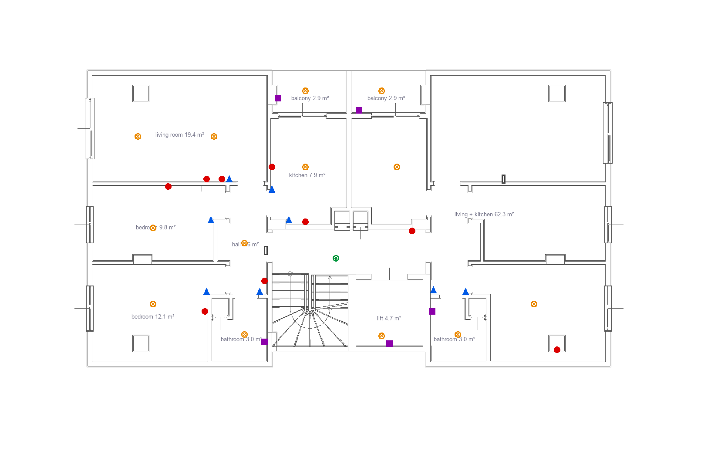

Ours vs the engineer's:

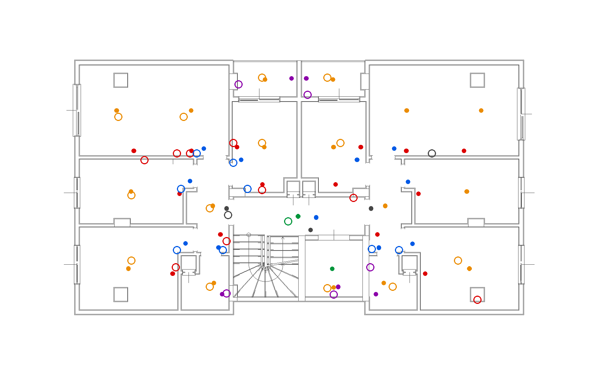

| Device | Ours | Engineer | Within 50 cm | Within 1 m |
|---|---:|---:|---:|---:|
| ceiling light | 49 | 47 | 33 | 36 |
| socket | 38 | 41 | 17 | 25 |
| wet-area socket | 18 | 15 | 5 | 8 |
| switch | 32 | 31 | 21 | 23 |
| apartment panel | 7 | 7 | 5 | 5 |
| emergency light | 9 | 8 | 2 | 2 |

## Ali Kemal Arslan

- 3 floor plans found; sections, elevations, site plan and details removed
- 74 rooms read; 67 of 69 within 10% of the area the architect wrote
- 232 devices placed; agreement with the engineer **F1 0.66** (devices within 1 m)

Files: [1-architect-raw.dwg](ali-kemal-arslan/1-architect-raw.dwg) · [2-cleaned.dwg](ali-kemal-arslan/2-cleaned.dwg) · [3-electrical.dwg](ali-kemal-arslan/3-electrical.dwg)

The whole sheet: dark is what the cleanup kept, pink what it removed.

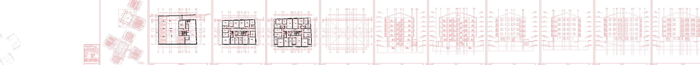

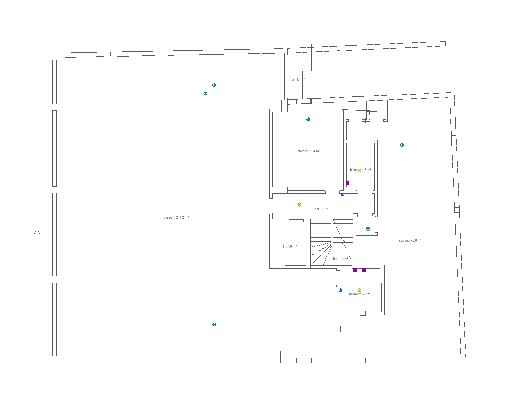

Ours vs the engineer's:

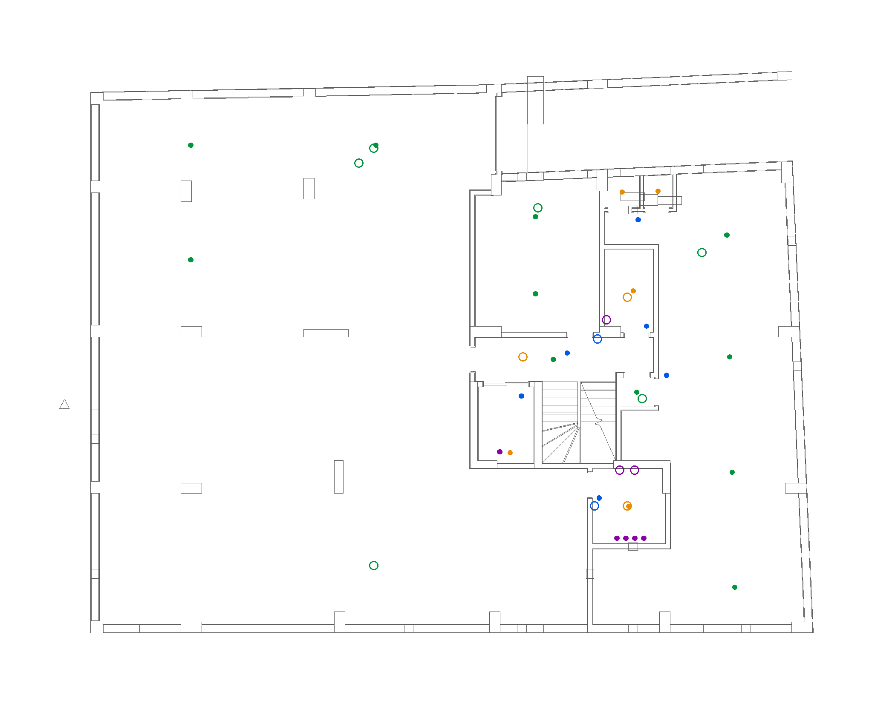

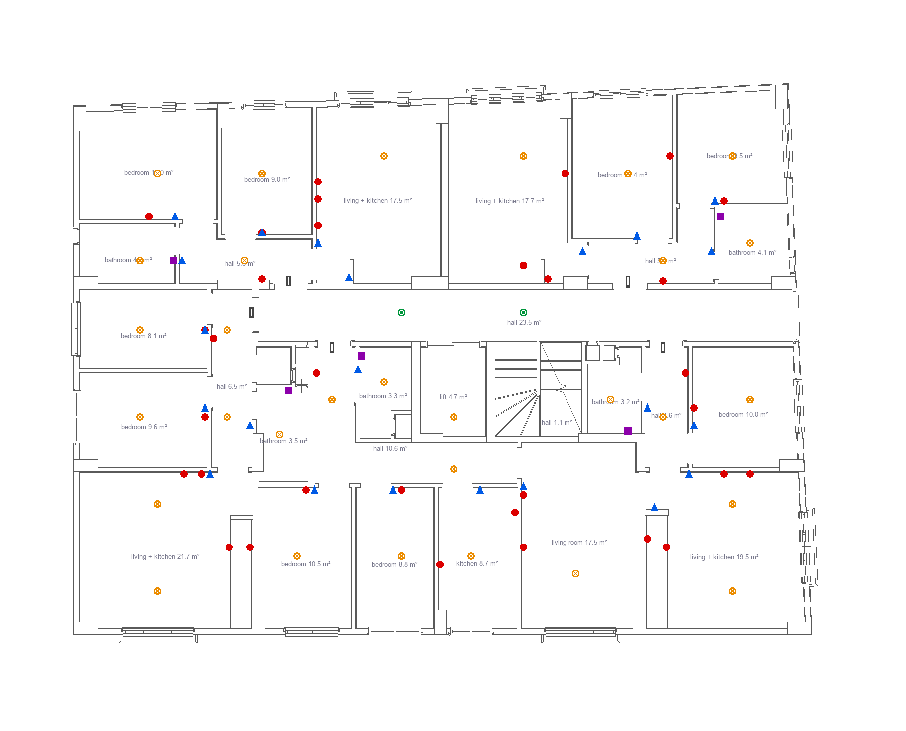

Ours vs the engineer's:

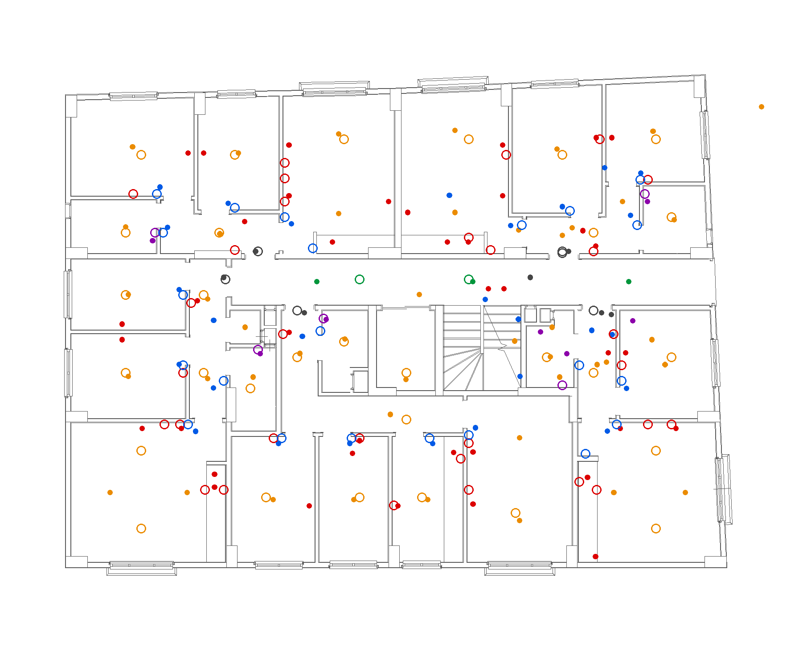

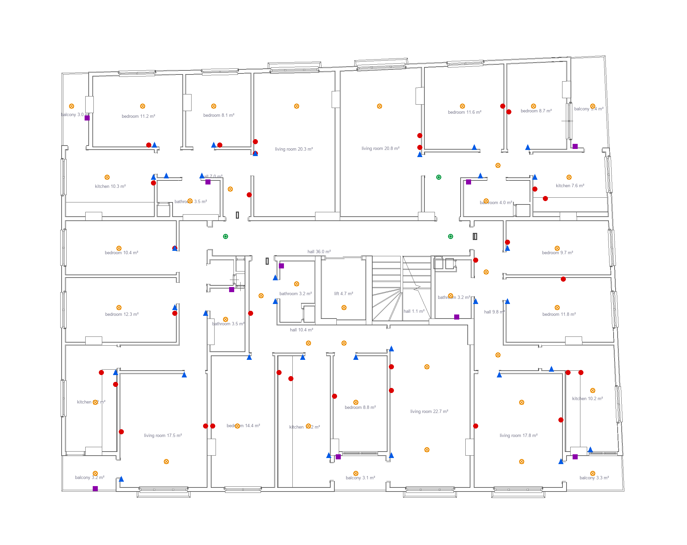

Ours vs the engineer's:

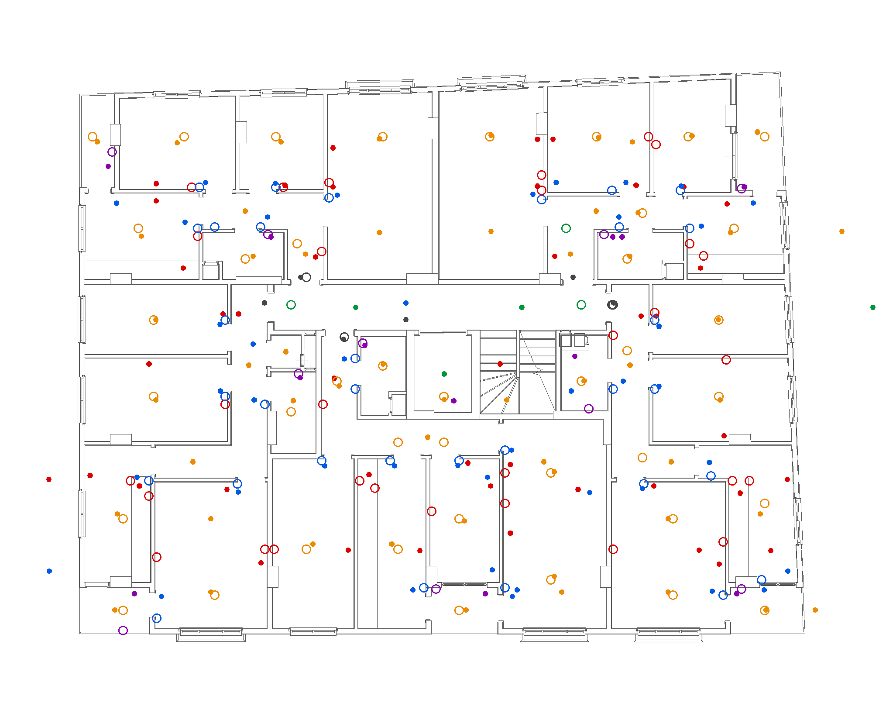

| Device | Ours | Engineer | Within 50 cm | Within 1 m |
|---|---:|---:|---:|---:|
| ceiling light | 73 | 103 | 62 | 67 |
| socket | 64 | 81 | 29 | 39 |
| wet-area socket | 18 | 24 | 11 | 11 |
| switch | 56 | 75 | 47 | 50 |
| apartment panel | 10 | 13 | 8 | 8 |
| emergency light | 11 | 17 | 4 | 4 |

## Privacy

The drawings are anonymised (`cadai/demo/anonymise.py`, ADR-032): every text outside the floor plans (title block, site plan, project tables) was removed, and inside the plans anything that looks like an address, phone number, e-mail or ID number; embedded files and pictures were removed too. A scan of every string in the written files, including extended data, finds nothing personal. Owners' names may appear. The office agreed to this demo. The pictures are drawn from line geometry only.
